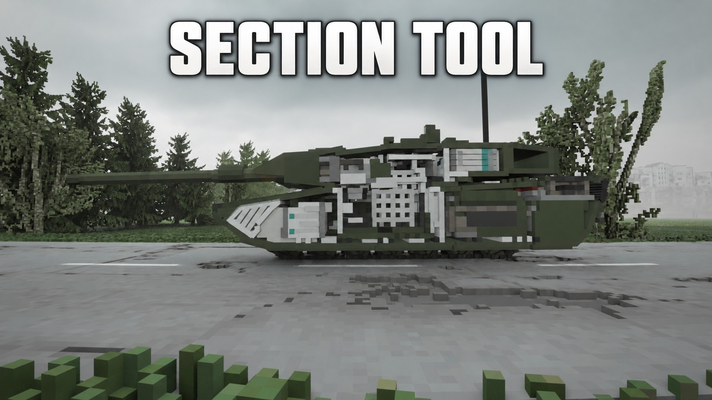

# TABS Section Tool

Reversible section views for [TABS] vehicles in Teardown — cut a vehicle open to inspect armor layout, crew positions and internals, then restore it with one click.

## Controls

| Key | Action |
|-----|--------|
| Q / E | Rotate section plane |
| C | Switch side |
| LMB | Section here |
| RMB | Restore the targeted vehicle and player collision |
| R | Restore all sections and player collision |

Single-player.

## Install

- **Steam Workshop:** subscribe [here](https://steamcommunity.com/sharedfiles/filedetails/?id=3815673375) (made for **[TABS] Vehicle Framework** vehicles).
- **Manual:** copy this folder to `Documents/Teardown/mods/`.

## Credits

By Andrew. Built for inspecting TABS vehicles (armor layouts, crew seats, modules).

中文：TABS 载具剖面工具。Q/E 旋转剖面，C 切换侧边，左键剖切，右键恢复，R 全部恢复。单人模式。

## License

MIT — see [LICENSE](LICENSE).

## v0.2.0: automatic player pass-through

Applying a section automatically lets the player pass through the entire targeted vehicle. There is no separate toggle or N key. Restoring a vehicle restores its player collision as well.

The implementation remaps collision layers and translates shape masks to preserve shape-to-shape collision relationships, including terrain support and vehicle components. It does not freeze vehicles, disable gravity, or make them intangible to every object.

### Compatibility and limitations

- Single-player only; TABS vehicles and recognized independent track segments.
- The engine has eight collision-layer bits. If insufficient free bits remain, the tool keeps the section view, restores normal collision, and shows a warning instead of disabling physical collision.
- Other mods using hard-coded layer masks for ray queries may require adaptation. Large-scene performance and actual player traversal still need in-game verification.
- TABS ballistic code can ignore invisible shapes, so section views may affect armor/penetration behavior.
- Newly spawned vehicle parts without inherited metadata may need a restore and another section operation.
- Move outside the vehicle before restoring collision. Reload the level when updating from an earlier version.

### Manual download

Download `Section-Tool-v0.2.0.zip` from Releases and extract its `section-tool` folder into `Documents/Teardown/mods/`. Enable Section Tool in the game. Use either the Workshop copy or the local copy to avoid running both simultaneously.

### Tests

Install `requirements-test.txt`, then run `python tests/test_section.py`.
The suite uses Lua 5.1 through Lupa: 1,096 clipping cases plus mocked vehicle handling and collision tests. Tests verify automatic activation, all shape-pair collision relationships, independent restoration of multiple vehicles, original player masks, inherited fragments, layer exhaustion, and removal of the N toggle. Mock tests do not substitute for in-game testing.
